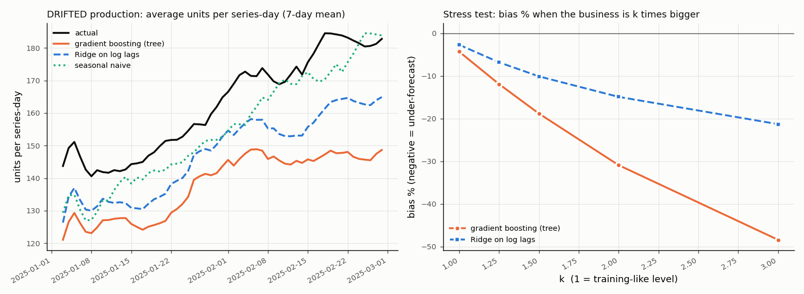

# Demand Forecasting - a retail ML system you can run on your laptop (Project 3)

A retailer sells 8 products in 3 stores. At the **end of every day D** the planners need **units sold on day D+1** for each product-store
(replenishment) and the next 7 days (weekly planning). Too high = stock waste, too low = lost sales.

This repo is a small but *real-looking* ML system: synthetic data -> time-aware features -> baselines and models -> MLflow -> batch forecast +
REST API -> Docker / Kubernetes -> monitoring (Prometheus, Grafana, KS drift) -> **scheduled and trigger-based retraining with human approval and rollback**.

```
DATA -> FEATURE ENGINEERING -> TRAINING -> EXPERIMENT TRACKING -> REGISTRY (champion/challenger) -> DEPLOYMENT (batch + API)
     -> MONITORING -> DRIFT DETECTION -> RETRAINING -> DEPLOYMENT ...
```

What this project teaches that the other projects do not: **time**. Time-based features (lag, rolling, seasonality), the **time-based split**, why a
**tree model cannot extrapolate** to a new demand level, why **drift is not the same as failure**, and how weekly / monthly / triggered retraining fit together.

> All data is synthetic (seeded; `docs/DATASET.md`). Numbers are plausible for teaching, not facts about real retail.

---------------------------------------------------------------------------------------------------------------------------------------

## 1. Quick start (about 3 minutes)

**Windows PowerShell** (Python 3.11 recommended)
```powershell
python -m venv .venv
.\.venv\Scripts\Activate.ps1
pip install -r requirements.txt
python -m src.data.make_dataset                   # 1. generate data (seconds)
python -m src.features.select_features            # 2. choose features on TRAINING rows only
python -m src.models.train --bootstrap-champion   # 3. train baselines + candidates, log to MLflow, install champion v1
pytest -q                                         # 4. 84 tests
python scripts/quality_gate.py                    # 5. CI-style minimum bar
uvicorn src.api.app:app --port 8000               # 6. serve (Swagger UI: http://localhost:8000/docs)
```
(or simply `.\scripts\run_local.ps1`)

**Linux / macOS / WSL** - the same commands, activate with `source .venv/bin/activate` (or run `bash scripts/run_local.sh`).

Then, in a second terminal:
```
python scripts/smoke_test.py --url http://localhost:8000          # health + one valid + one invalid request
python scripts/send_traffic.py --csv data/production/batch_normal.csv --n 200 --shuffle
```
Always run python **from the project root as a module** (`python -m src....`) so that imports like `from src import project` work.

---------------------------------------------------------------------------------------------------------------------------------------

## 2. Folder map

| Path | Purpose |
|---|---|
| `src/data/make_dataset.py` | seeded generator: trend, seasonality, holidays, promotions, price effects, stock-outs, outliers, missing values, production batches |
| `src/data/profile_data.py` | data profile: shape, missing, zeros, weekly trend table, correlations |
| `src/features/build_features.py` | **the** feature function `compute_features` (training, batch, API all call it) |
| `src/features/history_store.py` | in-memory stand-in for an **online feature store** (recent sales history -> lag/rolling features at request time) |
| `src/features/definitions.py`, `calendar.py` | column groups, split dates, holiday calendar (known in advance) |
| `src/features/select_features.py` | filter / wrapper / embedded selection, run on **training rows only** |
| `src/features/registry.py` + `configs/feature_registry.yaml` | feature metadata + **approval gate** (`check_features_approved`) |
| `src/features/leakage_demo.py`, `manual_examples.py` | wrong-vs-right demos; hand calculation vs code |
| `src/features/data_quality.py` | schema, duplicates, nulls, price-unit, gaps - step 1 of the retraining ladder |
| `src/models/train.py` | chronological split, baselines, Ridge-on-log vs gradient boosting, MLflow, champion rule |
| `src/models/evaluate.py`, `metrics.py`, `explain.py` | WAPE / bias / MAE / cost, segments, permutation importance, SHAP (optional) |
| `src/models/trend_shift.py` | the **extrapolation lesson** (figure in `docs/`) |
| `src/models/batch_forecast.py`, `weekly_job.py` | weekly batch forecast (7 days, recursive) + idempotent history refresh |
| `src/models/retrain.py` | **the retraining workflow** (scheduled / trigger, rolling / expanding, champion vs challenger, approval, rollback) |
| `src/models/rolling_origin.py` | OPTIONAL `TimeSeriesSplit` evaluation |
| `src/common/` | artifact I/O, KS drift, decision ladder, promotion + registry, MLflow helpers, paths, params |
| `src/api/app.py`, `src/project.py` | FastAPI app (shared) + the project contract (request/response, history store, demand band) |
| `src/monitoring/` | `run_drift_check` (KS + ladder), `performance` (weekly WAPE trigger), `drift_exporter` (Prometheus), `failure_scenarios` |
| `configs/` | `params.yaml`, `retrain_policy.yaml`, `selected_features.yaml`, `feature_registry.yaml`, `quality_gate.json`, `sample_request.json` |
| `tests/` | 84 tests (data, features, leakage, model, history-store parity, API, drift ladder, retraining, promotion) |
| `notebooks/01_walkthrough.ipynb` | short teaching notebook (all cells executed, outputs stored) |
| `docs/DATASET.md`, `docs/sample_outputs/` | data dictionary; the **real console output** of every demo command |
| `dvc.yaml`, `MLproject`, `Dockerfile`, `docker-compose.yml`, `k8s/`, `monitoring/`, `.github/workflows/ci.yml` | pipeline, packaging, deployment, observability, CI |
| `scripts/` | `quality_gate.py`, `smoke_test.py`, `send_traffic.py`, `api_session.py`, `traffic_demo.py`, `static_checks.py`, `capture_outputs.py`, `build_results.py` |
| `data/`, `models/`, `logs/`, `reports/`, `mlflow.db` | **generated** (git-ignored) |

---------------------------------------------------------------------------------------------------------------------------------------

## 3. The one rule: "would this be known at prediction time?"

We forecast **at the end of day D for day D+1** (horizon 1). Only data up to day D exists.

| Known in advance for the forecast day (allowed) | NOT known (forbidden) |
|---|---|
| calendar, holiday, **planned** price / discount / promotion, weather **forecast** | **sales** of the forecast day, **actual** temperature, any rolling window that touches day D+1 |

Every feature has a row in `configs/feature_registry.yaml` with owner, calculation logic, `prediction_time_availability`, status (Approved / Rejected + reason)
and version. `train.py` and `retrain.py` call `check_features_approved()` and **refuse** a Rejected or unknown feature (try adding `temperature` to
`configs/selected_features.yaml` and run `train` - it stops with the reason).

Lag features, per `(product, store)` series, on a complete daily calendar:
```
lag_k          = sales.shift(k)
rolling_mean_w = sales.shift(1).rolling(w).mean()      # shift FIRST, then roll -> day t never sees day t
```
Worked example (`docs/sample_outputs/02_feature_manual_examples.txt`): sales days 1..8 = 10,12,11,13,20,22,21,14. For day 8:
`rolling_mean_7 = mean(10,12,11,13,20,22,21) = 15.57` (code agrees); without the shift it would be 16.14 and include day 8's own sales.

---------------------------------------------------------------------------------------------------------------------------------------

## 4. The pipeline, step by step

Every command prints a lot on purpose (it is a teaching tool). The captured output of each is in `docs/sample_outputs/`.

| # | Command | What you learn | Captured output |
|---|---|---|---|
| 0 | `python -m src.data.make_dataset` | what is generated, files written | `00_make_dataset.txt` |
| 1 | `python -m src.data.profile_data` | shape, missing (sales 0.46%, forecast_temp 1.5%), 42 zero-sales days, weekly level table (training 100->130 design level vs drifted production 150->210), correlated features | `01_data_profile.txt` |
| 2 | `python -m src.features.manual_examples` | hand calculation = code for rolling, lag, missing day, price features, sin/cos; online = offline parity | `02_...` |
| 3 | `python -m src.features.select_features` | filter (abs corr, mutual information), wrapper (RFE), embedded (Lasso) votes; redundancy check; domain rules | `03_feature_selection.txt` |
| 4 | `python -m src.features.leakage_demo` | random vs time split, centred / un-shifted rolling window, scaler on all data, actual vs forecast temperature | `04_leakage_demo.txt` |
| 5 | `python -m src.models.train --bootstrap-champion` | 3 baselines vs Ridge-on-log vs gradient boosting on a **chronological** split; champion rule; MLflow | `05_train_mlflow.txt` |
| 6 | `python -m src.models.evaluate` | WAPE / bias / MAE / cost, segments (holiday, promotion, product), why not MAPE | `06_evaluation.txt` |
| 7 | `python -m src.models.explain` | permutation importance, linear view, SHAP (optional); association is not causation | `07_explainability.txt` |
| 8 | `pytest -v` | 84 tests | `08_pytest.txt` |
| 9 | `python scripts/api_session.py` | a scripted API session + latency benchmark | `09_api_session.txt` |
| 10-11 | `python -m src.monitoring.run_drift_check --prod data/production/batch_{normal,drifted,festival}.csv [--ref-window seasonal]` | KS drift + ladder, with the festival "expected shift" | `10*`, `11*` |
| 12 | `python -m src.models.retrain ...` | retraining workflow incl. approval + rollback | `12_retrain_promotion.txt` |
| 13 | `python -m src.monitoring.failure_scenarios` | stale history, MAPE explosion, duplicated dates, price unit change | `13_failure_scenarios.txt` |
| 14 | `python -m src.models.trend_shift` | **trees cannot extrapolate**; figure `docs/trend_shift_extrapolation.png` | `14_...` |
| 15-16 | `python -m src.models.batch_forecast [--backtest]`, `python -m src.models.weekly_job ...` | weekly batch forecast, backtest by horizon, idempotent refresh | `15_...`, `16_...` |
| 18 | `python -m src.models.rolling_origin` (OPTIONAL) | `TimeSeriesSplit`: 5 folds show how much accuracy varies | `18_...` |
| 19 | `python scripts/traffic_demo.py` | API -> prediction log -> drift exporter, normal vs drifted traffic | `19_...` |

### 4.1 Headline results (measured; see the output files for the full tables)

**Time-based split** (train 2023-01..2024-06, valid 2024-07..09, test 2024-10..12, champion re-fitted on train+valid, test touched once)

| model (test period) | WAPE | bias | MAE (units) |
|---|---|---|---|
| naive (yesterday) | 0.194 | -0.1% | 23.6 |
| seasonal naive (same weekday last week) | 0.208 | -0.5% | 25.3 |
| moving average 7 | 0.186 | 0.0% | 22.7 |
| **champion v1: gradient boosting (14 features)** | **0.129** | -2.3% | 15.6 |

38% fewer errors than seasonal naive; in the validation period Ridge-on-log had WAPE 0.135 and gradient boosting 0.130, so by the documented champion rule
(lowest validation WAPE with |bias| <= 3%) gradient boosting wins. **We report what we measured; we did not pre-ordain the champion.**

**Leakage numbers** (`04_leakage_demo.txt`, honest): a random split understates the error by only ~2% here (lag features carry most of the signal), yet 99% of the
test labels already sit inside training features after the shuffle. The big leaks are the rolling-window mistakes: an un-shifted window gives WAPE 0.087 and a
centred window 0.111 versus 0.130 for the correct features - results that are *impossible* in production.

**The extrapolation lesson** (`14_trend_shift_extrapolation.txt`, models trained through 2024-09-30):

| WAPE (bias) | normal batch | drifted batch (level 150->210) |
|---|---|---|
| seasonal naive | 0.204 (-0.3%) | 0.191 (-4.3%) |
| Ridge on log | 0.131 (-2.7%) | 0.140 (-9.2%) |
| gradient boosting | 0.132 (-4.3%) | **0.196 (-15.3%)** |



A tree leaf stores an *average of training targets*, so forecasts cannot exceed what was seen. The log-linear model follows the level better but still under-forecasts
(Ridge shrinks weights). Neither is the cure: the cure is **retraining** (and scale-free modelling). Giving the tree a `trend_index` clock helps on this shift but only
because the shift keeps climbing (experiment D in the output) - it is a trap, not a fix.

### 4.2 Model choice (why not something fancier?)
* **Baselines first** - if a model cannot beat "same weekday last week", it is not worth deploying.
* **Ridge on log(sales)** - demand is *multiplicative* (a promotion adds +40% to any series); log turns "x1.4" into "+0.34". Uses log-lags, so it can follow a new level.
* **Gradient boosting** (`HistGradientBoostingRegressor`) - learns interactions (promotion x weekend x product) without hand-made features.
* **Not** LSTM / Prophet / ARIMA: the course stack is sklearn; per-series models would need 24 fits and cannot share what one product teaches another; a pooled model with
  lag features is strong, fast and explainable.
* **Metrics** - WAPE (= sum|error| / sum units; "what share of units did we get wrong?"), **bias** (= sum(forecast - actual) / sum units; negative = stock-outs, positive = waste),
  MAE (units), RMSE. **MAPE is not used**: with zero-sales days it is infinite (`13_failure_scenarios.txt`). `roc_auc` in the artifact is a *project-specific* extra: how well the
  forecast ranks "spike days" (sales > 1.15 x recent level) above normal days; the quality gate needs it because every project in the course shares one artifact contract.

### 4.3 Explainability (`07_explainability.txt`)
Permutation importance on the test period (MAE increase when a column is shuffled): `lag_1` 13.2, `rolling_mean_7` 13.0, `day_of_week` 3.3, `product_id` 1.8 ...
The level features are correlated, so each understates the group (together ~29 units). Importance describes the **model**; it does not prove that a promotion *causes* sales.

---------------------------------------------------------------------------------------------------------------------------------------

## 5. Batch vs real-time serving (same model, same features)

| | Batch (primary) | Real-time API |
|---|---|---|
| command | `python -m src.models.batch_forecast` / `python -m src.models.weekly_job ...` | `POST /predict` |
| unit | all 24 series x next 7 days -> `reports/forecast_next_7d.csv` | one product-store-date |
| when | every Monday (planning) | on demand (replenishment screen, "what if I run a promotion?") |
| features | recursive: day D+2 uses our own forecast of D+1 as `lag_1` | lags come from the **history store** (`data/processed/sales_history.csv`) |
| known plan | assumes list price, no promotion, average temperature | the request carries price, discount, promotion, holiday, forecast_temp |

**Recursive forecast, simply:** the model forecasts one day ahead because its features are "yesterday's numbers". For 7 days we walk forward and feed each forecast back as
the next day's `lag_1`. Errors accumulate: the backtest (`15_batch_forecast.txt`) shows WAPE 0.146 at horizon 1 rising to ~0.15-0.17, still better than seasonal naive at every
horizon (0.19-0.23). Horizon 1 is *worse* than the 0.129 test WAPE because the batch job does not know future promotions - the API gets them in the request.

**API** (`/docs` for Swagger): request `product_id, store_id, forecast_date, price, discount, promotion, holiday, forecast_temp` (pydantic ranges -> invalid input = HTTP 422).
Response `predicted_units, lower, upper` (80% interval from validation residual quantiles - OPTIONAL), `demand_band` (LOW / NORMAL / HIGH vs the 7-day average), `model_version`,
`history_last_date`, `history_stale_days`, `warnings`. Extra: `GET /health` (also reports the history store), `/model-info`, `/metrics` (Prometheus).
Measured locally (200 sequential requests, client side): p50 ~53 ms, p95 ~66-74 ms - most of it is rebuilding features from the 60-day history window, not the model.

**No training-serving skew:** the API calls the *same* `compute_features` as training. `tests/test_history_store.py` proves online features equal offline features, and
`tests/test_api.py::test_api_matches_offline_scoring` proves the API number equals the offline number. The history store refuses duplicated history, answers with a
warning when it is 1-3 days stale and refuses beyond 3 days (a forecast from old lags is worse than no forecast).

---------------------------------------------------------------------------------------------------------------------------------------

## 6. MLflow, DVC, Docker, Kubernetes, observability

### MLflow UI
```
mlflow ui --backend-store-uri sqlite:///mlflow.db        # then open http://127.0.0.1:5000
```
Experiment `demand_forecast_model`: one run per baseline, one per candidate, one `final_<model>_<version>` run with test metrics and the logged sklearn pipeline.
Compare runs by selecting them and pressing "Compare". `retrain.py` writes its challenger to `models/challenger.joblib` and the approval record to `reports/approval_record.json`.

### DVC (pipeline as a graph)
```
dvc init --no-scm            # (or `dvc init` inside a git repo)
dvc config core.analytics false
dvc repro                    # make_data -> features -> select -> train -> evaluate   (~45 s)
dvc dag                      # draw the graph
dvc metrics show             # reports/metrics.json
dvc params diff              # after editing configs/params.yaml
# versioning a data file and a LOCAL remote (no cloud account needed):
dvc add data/raw/sales_daily.csv
dvc remote add -d localstore ../dvc-store
dvc push
```
`dvc.yaml` declares dependencies, params and outputs of each stage; change `configs/params.yaml` (e.g. `hgb.max_iter`) and only `train` and `evaluate` re-run.
Note: a promotion changes `models/champion.joblib`, so `dvc status` will report the train stage as changed - that is the point of a champion that moves.

### Docker
```
python -m src.data.make_dataset && python -m src.features.select_features && python -m src.models.train --bootstrap-champion
docker build -t demand-forecast:1.0 .
docker run -p 8000:8000 demand-forecast:1.0
python scripts/smoke_test.py --url http://localhost:8000
```
The image contains `src/`, `models/champion.joblib`, `data/processed/reference.csv`, `data/processed/sales_history.csv` (the history store) and `configs/`. It runs as a
non-root user and has a health check. Use `python scripts/static_checks.py` before building (checks COPY sources, imports without dev packages, k8s labels).

### Kubernetes with Minikube
```
minikube start
docker build -t demand-forecast:1.0 .
minikube image load demand-forecast:1.0       # the cluster cannot see your local Docker images otherwise
kubectl apply -f k8s/
kubectl get pods                              # wait for 2/2 Ready
minikube service demand-forecast --url        # prints the URL; then run scripts/smoke_test.py --url <that url>
kubectl logs deploy/demand-forecast
kubectl delete -f k8s/                        # clean up
```
Two replicas, readiness + liveness probes on `/health`. A pod whose history store failed to load reports `degraded` on `/health` (HTTP 200 with status degraded) - see Troubleshooting.

### Observability stack (Docker Compose)
```
docker compose up --build        # API :8000, Prometheus :9090, Grafana :3000 (admin/admin), drift exporter :9100
python scripts/send_traffic.py --csv data/production/batch_normal.csv --n 300 --shuffle
python scripts/send_traffic.py --csv data/production/batch_drifted.csv --n 300 --shuffle
```
Grafana dashboard "ML Service Overview": request rate, error ratio, latency p50/p95, predictions by demand band, mean predicted units, KS statistic per feature, drift flags.
Note: the container uses the *normal* history; for drifted traffic with matching lags start a local API with
`HISTORY_PATH=data/processed/sales_history_drifted.csv` (`scripts/traffic_demo.py` does exactly this and prints the exporter gauges).
Reading the gauges: a flag means "the inputs look different from training". It is a **signal** - see the runbook.

### CI/CD (GitHub Actions, `.github/workflows/ci.yml`)
`test` job: install -> generate data -> select features -> train -> `pytest` -> quality gate (`configs/quality_gate.json`: roc_auc >= 0.70, WAPE <= 0.16, |bias| <= 8%).
`build` job: rebuild the model and build the Docker image; the push step runs only on `main` and only if Docker Hub secrets exist. Deployment to a cluster is intentionally
manual (needs credentials): `kubectl set image deployment/demand-forecast api=<image>`.

---------------------------------------------------------------------------------------------------------------------------------------

## 7. Drift and retraining runbook

### 7.1 Is a distribution shift automatically a model failure?  **No.**

| Case | Inputs (KS test) | Labelled performance | Decision | Output file |
|---|---|---|---|---|
| **Festival lead-up** (Diwali, expected seasonal shift) | `rolling_mean_7` D = 0.125, p = 6e-7 -> drift | WAPE ~0.145 (test period 0.129), bias -1.7% | **MONITOR** - lags followed the level | `11b_...` (with the seasonal reference window `11c_...`, `lag_1` and `rolling_mean_7` shrink to "significant but small") |
| **Normal batch, trend continues** | `rolling_mean_7` D = 0.102, p = 2e-10 -> drift; `lag_1` D = 0.074 significant but small | stable | **MONITOR** | `10_...` |
| **Trend shift 150 -> 210** | `lag_1` D = 0.240, `rolling_mean_7` D = 0.263, p ~ 1e-67 | weekly WAPE +47% .. +78% above validation in each of the last 4 weeks, bias -20% | **RETRAIN_CANDIDATE** | `11_...` |

KS test in one paragraph: **H0** = reference and production values come from the same distribution. `D` (0..1) is the largest gap between the two empirical CDFs (the *effect size*);
the **p-value** says how surprising such a gap would be if H0 were true. alpha = 0.05. With thousands of rows even tiny gaps are significant, so we also require `D >= 0.10`
("significant but small" is real but not worth acting on). A large p-value is **not** proof of no drift.

Festival weeks are *expected* drift. Compare them with a **seasonal reference window** (`--ref-window seasonal`: training rows from the same time of year, +-14 days) so only
the *unexpected* part of the shift remains.

### 7.2 The decision ladder (cheapest check first) - `src/common/retrain_decision.py`
1. **Data quality** (schema, duplicates, nulls, price units, calendar gaps). Failed -> `FIX_DATA_PIPELINE`; never retrain on broken data.
2. **Drift** (KS on lag / rolling / price / discount / weather).
3. **Labelled performance** - in retail labels arrive the next day, so weekly WAPE and bias are measured (`src/monitoring/performance.py`).
4. **Business impact** - |bias| of the last two weeks >= 10% of units = HIGH (stock-outs / waste).
Only `RETRAIN_CANDIDATE` means "train a challenger" - and the challenger still has to win. **Drift alone never triggers a retrain**; the forecasting policy additionally demands that the
lag/rolling features really drifted (otherwise accuracy fell for another reason: look for a data or label problem first).

### 7.3 Retraining strategy (documented in `configs/retrain_policy.yaml`, coded in `src/models/retrain.py`)

| Cadence | What happens | Command |
|---|---|---|
| **Weekly** (Monday) | refresh the history store with last week's actuals (idempotent upsert) + 7-day batch forecast. **No new model.** | `python -m src.models.weekly_job --new-actuals <batch.csv> --through <date>` |
| **Monthly** (1st) | scheduled retrain on a **rolling** 12-month window or an **expanding** window, regardless of drift | `python -m src.models.retrain --prod <batch.csv> --mode scheduled --strategy rolling` |
| **Trigger** | weekly WAPE >= 25% above the validation WAPE in 2 consecutive weeks AND KS drift in the lag/rolling features | `python -m src.models.retrain --prod <batch.csv>` (default mode `trigger`) |

The comparison is deliberately fair: the challenger is trained on history *before* a 14-day validation window (which picks Ridge vs boosting), then re-fitted; **champion and challenger
are both scored on the same most recent 28 days** that neither saw. Promotion needs: WAPE at least 0.5 points lower AND |bias| <= 8% AND bias not > 1 point worse than the champion.
The 8% limit is a documented policy choice (below the 10% "HIGH impact" line); 5% would have blocked even a good challenger on this shift.
Then an **approval record** is printed and the job stops at *awaiting approval* - a human adds `--approve-as NAME`. A sign-off cannot override a failed rule.

What `12_retrain_promotion.txt` shows (5 runs):
1. Normal batch, trigger mode -> ladder says MONITOR -> **STOP** (drift is a signal, not a command).
2. Normal batch, `--mode scheduled` -> challenger trained; hold-out WAPE 0.1346 -> 0.1340, improvement 0.0006 < 0.005 -> **NOT PROMOTED** (the monthly job ran, the champion stays).
3. Drifted batch, `--compare-strategies` -> hold-out WAPE: champion 0.2135 (bias -17.3%); **rolling challenger 0.123 (bias -6.2%)**, expanding challenger 0.160 (bias -10.5%, it picked
   boosting on the 14-day validation window - which cannot extrapolate). All rules pass -> **AWAITING APPROVAL**.
4. `--force-model hgb --approve-as planner_asha` -> WAPE improves but |bias| 12.2% > 8% -> **NOT PROMOTED** even with sign-off (guardrail).
5. `--approve-as planner_asha --demo-rollback` -> **PROMOTED**, then `promotion.rollback()` restores v1; the registry (`models/registry.json`) shows both.
Rolling vs expanding is data dependent: on the *normal* batch the expanding window was slightly better, on the *shift* batch the rolling window won - measure on your data.

After a real promotion: restart the API (or `kubectl rollout restart deployment/demand-forecast` after rebuilding the image) so it loads `models/champion.joblib`.

---------------------------------------------------------------------------------------------------------------------------------------

## 8. Failure scenarios reproduced (`13_failure_scenarios.txt`, tests in `tests/`)

| Scenario | Symptom | Detection | Fix |
|---|---|---|---|
| (a) **Stale history store** (nightly refresh did not run) | forecasts keep describing the festival after it ends; WAPE decays each stale day | `history_stale_days` + warning in every response; `/health` shows `history_last_date`; store refuses beyond 3 days | run the weekly job; alert on stale history |
| (b) **MAPE explodes** on zero-sales days | MAPE = inf after one stock-out | `mape_naive` shown vs WAPE; test asserts WAPE finite | report WAPE + bias |
| (c) **Duplicated dates** after a pipeline retry | rolling means silently wrong (208.4 vs 213.6 in the example) | `check_history`, data-quality `duplicates`, tests | idempotent `upsert_history` |
| (d) **Price unit change** (x100) | linear model forecasts collapse; price drift | data-quality `price_unit` + `price_range`; API range check (HTTP 422) | fix at source, do not retrain on the bad week |

---------------------------------------------------------------------------------------------------------------------------------------

## 9. Troubleshooting

| Problem | Fix |
|---|---|
| `ModuleNotFoundError: No module named 'src'` | run from the project root with `python -m src....` (not `python src/...py`) |
| API `/health` says `degraded` | `history_error` shows why; run `python -m src.data.make_dataset` (creates `data/processed/sales_history.csv`) and restart |
| `/predict` returns 422 "behind forecast_date" | history is > 3 days older than `forecast_date`; use dates up to 2025-03-03 with the default history, or refresh it |
| `FeatureNotApproved` during train | the feature is Rejected / unknown in `configs/feature_registry.yaml` (this is the gate working) |
| `FileNotFoundError: models/champion.joblib` | `python -m src.models.train --bootstrap-champion` |
| `mlflow ui` shows nothing | start it from the project root with `--backend-store-uri sqlite:///mlflow.db` |
| MLflow pickle warning at train time | expected: sklearn models are stored with cloudpickle (HistGradientBoosting is not on the safe list) |
| Windows: `Activate.ps1 cannot be loaded` | `Set-ExecutionPolicy -Scope Process Bypass` |
| `minikube image load` is slow | normal for the first load; check `minikube image ls` |
| Docker build fails at `COPY models/champion.joblib` | train first (generated files are git-ignored) |
| `dvc repro` re-runs everything | you edited a dependency (e.g. `configs/feature_registry.yaml`); `dvc dag` / `dvc status` show which |
| Container logs `InconsistentVersionWarning` / model fails to load | the scikit-learn in the image differs from the one that trained the model; pin the same version in `requirements-serving.txt` (`pip freeze`) and rebuild |
| API is slow (> 200 ms) on a small machine | single-row scoring is limited to one thread already (`threadpool_limits`); close other apps |

---------------------------------------------------------------------------------------------------------------------------------------

## 10. CORE vs OPTIONAL

* **CORE**: time split, lag/rolling features, baseline comparison, WAPE/bias, feature registry + gate, KS drift + decision ladder, scheduled + trigger retraining with
  champion/challenger on the same hold-out, batch forecast, FastAPI + history store, MLflow, DVC, Docker, Kubernetes, CI.
* **OPTIONAL** (never needed by the core pipeline; marked `OPTIONAL` in the code): `TimeSeriesSplit` rolling-origin evaluation (`rolling_origin.py`), prediction intervals from
  residual quantiles, SHAP (`explain.py`), cyclical sin/cos encodings (computed, not selected), Prometheus/Grafana stack.

## 11. Exercises
1. Add `lag_28` to the registry (all fields!), build it in `compute_features`, re-run selection and training. Does the validation WAPE move?
2. Change `retrain_policy.yaml: monthly_scheduled.window_months` to 6 and compare rolling vs expanding with `--compare-strategies`.
3. Break the history refresh (skip the weekly job for 5 days) and watch the API warnings and refusal.
4. Raise `promotion.guardrails.max_abs_bias_pct` to 0.15 and re-run `--force-model hgb --approve-as you`. Discuss: who should own that number?
5. Plot weekly WAPE of the champion on the drifted batch from `reports/facts/performance_batch_drifted.json`.

## 12. What was verified in the authoring environment (honest note)

Authored and verified on Linux, Python 3.11, pandas 3 / numpy 2 / scikit-learn 1.8 / mlflow 3, from a **clean copy** (data, models, logs, MLflow store deleted first):
data generation, feature + selection steps, training with `--bootstrap-champion`, `pytest` (84 passed), quality gate, a real `uvicorn` server with `scripts/smoke_test.py`, `scripts/send_traffic.py`
(normal and drifted), `/metrics`, the drift exporter (one update and served over HTTP), `run_drift_check` (normal vs drifted vs festival), `retrain.py` end to end including approval and rollback,
every notebook code cell executed, `dvc init --no-scm && dvc repro` (works offline, ~45 s), and the static checks.
**Not run here** (no Docker daemon, no Minikube): `docker build/run`, `docker compose up`, `minikube`/`kubectl apply`, GitHub Actions. Those files are validated statically only
(`scripts/static_checks.py`: YAML parses, every `COPY` source exists, the CMD module imports without development-only packages, Service selector = pod labels, image names agree).
Expect to fix small environment-specific issues (proxy, Docker Desktop resources) the first time you run them. Timings quoted above are from a small Linux VM.
